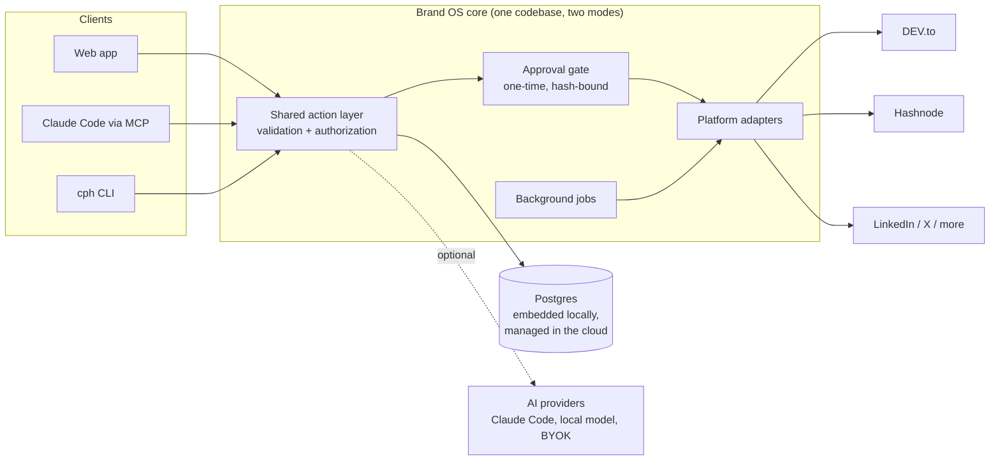
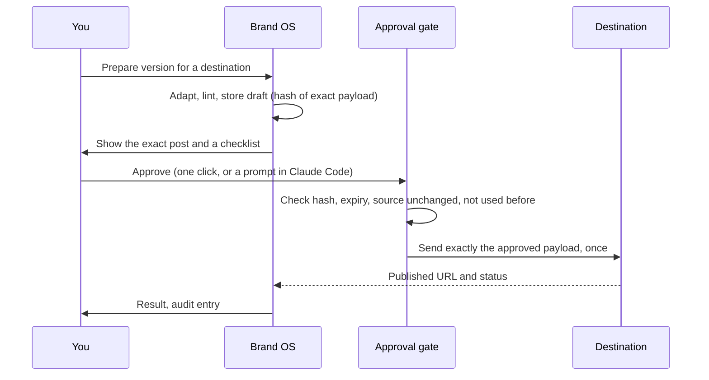
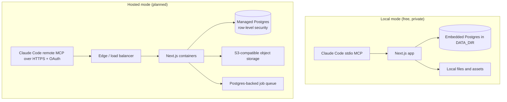

# Brand OS

**Write once. Publish everywhere. Nothing goes out without your approval.**

Brand OS is a local-first, self-hostable studio for technical writers and engineering teams. You write or import one article, improve it, preview a tailored version for every destination, and publish each one only after you approve that exact post. The same code runs on your laptop for free and, later, as a multi-tenant cloud service.

- **Local first.** Your drafts and your private knowledge base stay on your machine. No account, no AI key and no paid service are needed.
- **AI is optional.** Everything essential works with AI off. When you want help, plug in Claude Code (over MCP), a local model, or your own API key.
- **Approval by design.** A server-side gate refuses to publish anything that is not tied to a one-time approval of the exact text, so neither a bug nor an AI agent can post on your behalf.
- **Built for engineers.** Code blocks, tables, diagrams and canonical links survive the trip to each platform.

## Status

| Area | State |
|---|---|
| Publishing engine: approval gate, dev.to route, Buffer route, local dashboard, MCP server, `cph` CLI | Built and tested |
| Web app shell on embedded Postgres, design system, health checks | Built |
| Accounts, tenant isolation, private knowledge base, onboarding | Built |
| Article studio: Markdown editor, autosave, version history, import, assets, reading view | Built |
| AI assistance, platform previews, more destinations | Planned (see [roadmap](#roadmap)) |
| Hosted cloud service, team workspaces | Planned |

Nothing here is a mock-up: unfinished features are hidden or shown as clearly disabled.

## How it fits together



Every client, including AI agents, goes through the same action layer. Business rules and approvals live in the backend, so an AI cannot bypass them.

### What happens when you publish



If the draft or its source changes after you approve, the approval is void. A publish that fails halfway is marked unknown and is never retried automatically, so you cannot get a double post.

### Local mode and hosted mode



The data layer, schema and business logic are identical. Only the database driver, storage adapter and authentication differ.

## Run it locally

Requirements: Node 22 or newer and pnpm 10.

```bash
git clone https://github.com/ZeeshanAdilButt/content-powerhouse
cd content-powerhouse
cp .env.example .env
pnpm install
pnpm setup:local      # installs, runs migrations, prints how to start
pnpm web:dev          # web app at http://localhost:3100
```

No Docker and no database server are needed: local mode uses an embedded Postgres that stores its files in `DATA_DIR` (default `./.data`).

### Where your knowledge base lives

- Each person's data lives in the database, scoped to the signed-in user: profile, knowledge items, drafts, connections and history all carry that user's id, and every query is filtered by it. In local mode the database is embedded and stored under `DATA_DIR` on your machine (ignored by git, never uploaded). In hosted mode it is the managed Postgres, and one user can never see another's rows.
- Point `DATA_DIR` somewhere you back up (an encrypted drive, a synced private folder) in `.env`.
- Anyone can build their profile and knowledge base inside the app after signing in. To load existing private context in one go, put it in `apps/web/seed/owner.private.json`: a one-time, idempotent import into the owner account's rows. The file is gitignored, the import is tied to the owner's user id, and it never runs for any other account. After importing, the database is the source of truth and you can delete the file.
- You can always export your data as JSON from the app and delete individual items.

### Use it with Claude Code

The publishing engine ships an MCP server. After building, run the installer; it asks before every change it makes:

```bash
pnpm build
node packages/cli/dist/index.js install
```

It registers the MCP server with Claude Code at user scope, adds a logon task that runs the local daemon, and installs a guard hook that stops an AI from driving the approval dashboard. Then ask Claude things like "prepare this article for DEV.to". Claude can draft and stage private drafts; only you can approve.

### Connect your systems

1. Open the dashboard (`cph dashboard`) and go to **Connections**.
2. **DEV.to:** create an API key in your DEV.to settings and paste it into the dashboard card. Never paste keys into chat.
3. **Buffer (optional, for LinkedIn, X and YouTube):** create a free account, connect the channels, create one API key and paste it into the dashboard card.
4. **AI (optional):** point to a local model (Ollama or any OpenAI-compatible server), bring your own API key, or just use Claude Code over MCP.

Credentials are encrypted at rest with a master key held in your operating system's credential store, and they never appear in logs, MCP results or the UI.

## The cloud plan

The goal is the same product as a hosted service, reachable from a browser and from Claude connected in the cloud, so you can draft and approve from anywhere.

- **App tier:** stateless Next.js containers behind a load balancer, deployed from CI with infrastructure as code.
- **Data tier:** managed Postgres with row-level security as defense in depth on top of owner-scoped queries; S3-compatible object storage for media; a Postgres-backed job queue (no Redis until measurements justify it).
- **Isolation:** one tenant id on every row, enforced in a single data-access layer, with automated tests proving that user A cannot read, change, search or publish user B's data.
- **Secrets:** per-tenant envelope encryption with keys in a cloud KMS; provider tokens are never exposed to AI context.
- **Claude in the cloud:** a remote MCP endpoint over HTTPS with OAuth, so a user's own Claude connects to their own tenant. Brand OS never proxies or reuses anyone's Claude subscription; AI that runs inside the service uses the user's own API key or a local model.
- **Operations:** OpenTelemetry traces and metrics, structured audit events, point-in-time backups, per-user usage and cost visibility.

## Roadmap

| Phase | Focus |
|---|---|
| 1 (days 1-7) | Accounts and privacy, article studio, Claude MCP and AI providers, DEV.to and Hashnode publishing, composer with per-destination previews, hardening |
| 2 (days 8-12) | Ten-channel distribution: LinkedIn, X, Bluesky, Threads, DEV.to, Hashnode, Medium, Reddit, Hacker News, YouTube; calendar and approval queue |
| 3 (days 13-16) | Outreach to top technical publications with pitch tracking |
| 4 (days 17-20) | Conference talks: discover calls for proposals, proposal studio, submission tracking |
| 5 (days 21-24) | Video and motion graphics studio for technical explainers |
| 6 (days 25-28) | Series, knowledge graph recommendations, production-ready hosted service |
| Next | Software and product distribution (release announcements across developer platforms) and a local CLI agent provider for wording improvements |

Details and acceptance criteria are in [TODO.md](TODO.md); design decisions are in [DECISIONS.md](DECISIONS.md) and [ARCHITECTURE.md](ARCHITECTURE.md); verified platform capabilities and limits are in [INTEGRATIONS.md](INTEGRATIONS.md).

## Getting it in front of people

Distribution of Brand OS itself follows the product's own philosophy: depth over volume.

1. **Individuals first.** Practical, short demo videos on YouTube (and as vertical clips on LinkedIn): install in five minutes, write once and publish to three platforms with approval, why the approval gate makes double posts impossible, how the knowledge base stays on your machine. Each video links to a written deep dive and to the repo.
2. **Build in public.** Engineering write-ups of the real system design work: the hash-bound approval gate, tenant isolation tests, the embedded-to-managed Postgres switch, the cloud deployment.
3. **Then teams and companies.** Shared workspaces, review and approval workflows, brand voice guides, and publishing calendars for engineering blogs and developer relations teams, built on the same isolation and approval foundations.

## Security principles

- Public actions need explicit, per-action approval. There is no "approve all".
- No fabricated metrics, sources or experience; imported claims stay private and flagged for review until you confirm them.
- Browser automation, where used, runs in your own authorized session; there is no CAPTCHA or authentication bypass.
- Anything that talks to a model is opt-in and visible, with per-user usage shown.

## Contributing

Issues and pull requests are welcome. Run `pnpm test`, `pnpm typecheck` and `pnpm web:lint` before opening a pull request.
