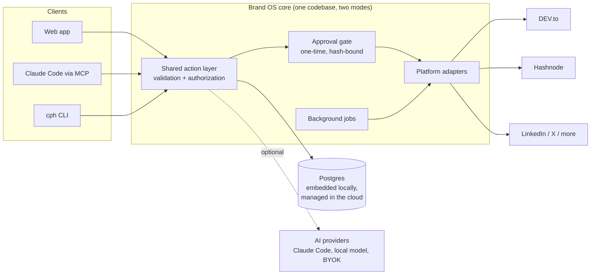
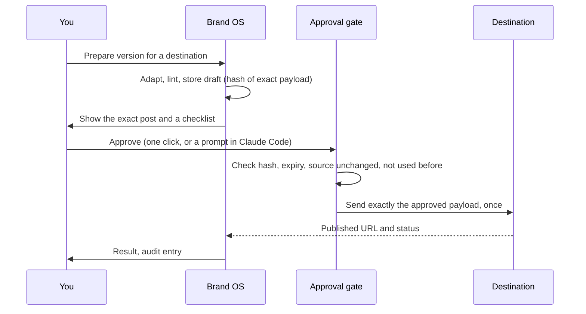
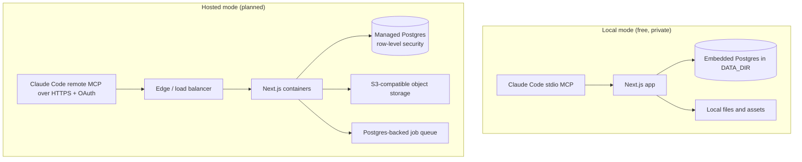

# Brand OS

**Write once. Publish everywhere. Nothing goes out without your approval.**

Brand OS is a local-first, self-hostable studio for technical writers and engineering teams. You write or import one article, improve it, preview a tailored version for every destination, and publish each one only after you approve that exact post. The same code runs on your laptop for free and, later, as a multi-tenant cloud service.

- **Local first.** Your drafts and your private knowledge base stay on your machine. No account, no AI key and no paid service are needed.
- **AI is optional.** Everything essential works with AI off. When you want help, plug in Claude Code (over MCP), a local model, or your own API key.
- **Approval by design.** A server-side gate refuses to publish anything that is not tied to a one-time approval of the exact text, so neither a bug nor an AI agent can post on your behalf.
- **Built for engineers.** Code blocks, tables, diagrams and canonical links survive the trip to each platform.

## Status

| Area | State |
|---|---|
| Publishing engine: approval gate, dev.to route, Buffer route, local dashboard, MCP server, `cph` CLI | Built and tested |
| Web app shell on embedded Postgres, design system, health checks | Built |
| Accounts, tenant isolation, private knowledge base, onboarding | Built |
| Article studio: Markdown editor, autosave, version history, import, assets, reading view | Built |
| AI assistance in the studio (local model, your own API key, or Claude Code hand-off), AI task inbox with diffs to accept or reject, agent API with per-user keys, and the `brand-os` MCP server for Claude Code | Built and tested |
| Technical publishing in the web app: connections, DEV.to and Hashnode adapters, private drafts, hash-bound single-use approval, the approved publish, recovery for an unknown result, and agent and MCP tools that can prepare and ask but never approve | Built and tested against local fake servers. **DEV.to live check pending the owner**; Hashnode is built from the official schema and is live-unverified |
| One Publishing screen (article, platforms, live previews), a one-at-a-time approval queue, an expert composer, 13 destinations with previews and manual posting, the personal site as a Markdown export or a GitHub pull request, a canonical page check, a directory of every planned platform, and saved integration values for platforms that are not built yet | Built and tested against local fake servers. DEV.to, Hashnode and GitHub are the only destinations that publish through the app; live checks pending the owner |
| Connections for every platform in the directory (45): one validated definition each, a Connect drawer with steps, deep links, the access asked for and a Test button, OAuth with PKCE and a code sign-in, renewal under a lock, and a health state in the platform list. Twenty-five platforms are manual with a stated reason, three stay at Set up because their check could not be confirmed | Built and tested against fake servers only. **No connection has been tried against a real account**: that is the owner's step, with their own keys and app registrations |
| More destinations that publish through the app (connecting is built; sending comes with Phase 2) | Planned (see [roadmap](#roadmap)) |
| Hosted cloud service, team workspaces | Planned |

Nothing here is a mock-up: unfinished features are hidden or shown as clearly disabled.

## How it fits together



Every client, including AI agents, goes through the same action layer. Business rules and approvals live in the backend, so an AI cannot bypass them.

### What happens when you publish



If the draft or its source changes after you approve, the approval is void. A publish that fails halfway is marked unknown and is never retried automatically, so you cannot get a double post.

### Local mode and hosted mode



The data layer, schema and business logic are identical. Only the database driver, storage adapter and authentication differ.

## Run it locally

Requirements: Node 22 or newer and pnpm 10.

```bash
git clone https://github.com/ZeeshanAdilButt/brand-os
cd brand-os
cp .env.example .env
pnpm install
pnpm setup:local      # installs, runs migrations, prints how to start
pnpm web:dev          # web app at http://localhost:3100
```

No Docker and no database server are needed: local mode uses an embedded Postgres that stores its files in `DATA_DIR` (default `./.data`).

### Where your knowledge base lives

- Each person's data lives in the database, scoped to the signed-in user: profile, knowledge items, drafts, connections and history all carry that user's id, and every query is filtered by it. In local mode the database is embedded and stored under `DATA_DIR` on your machine (ignored by git, never uploaded). In hosted mode it is the managed Postgres, and one user can never see another's rows.
- Point `DATA_DIR` somewhere you back up (an encrypted drive, a synced private folder) in `.env`.
- Anyone can build their profile and knowledge base inside the app after signing in. To load existing private context in one go, put it in `apps/web/seed/owner.private.json`: a one-time, idempotent import into the owner account's rows. The file is gitignored, the import is tied to the owner's user id, and it never runs for any other account. After importing, the database is the source of truth and you can delete the file.
- You can always export your data as JSON from the app and delete individual items.

### Use it with Claude Code

The publishing engine ships an MCP server. After building, run the installer; it asks before every change it makes:

```bash
pnpm build
node packages/cli/dist/index.js install
```

It registers the MCP server with Claude Code at user scope, adds a logon task that runs the local daemon, and installs a guard hook that stops an AI from driving the approval dashboard. Then ask Claude things like "prepare this article for DEV.to". Claude can draft and stage private drafts; only you can approve.

#### The `brand-os` server: your articles, knowledge and AI tasks

A second MCP server, `brand-os` (`packages/brand-mcp`), lets your own Claude Code read your profile and knowledge, list, read, create and update articles, and complete AI tasks you left in the inbox. It talks to the running web app over its agent API with a credential you create, and it can prepare platform drafts, stage private copies and ask for your approval, but it has no tool to approve or publish (only you can, in the app).

1. Start the app (`pnpm web:dev`) and build the server (`pnpm build`).
2. In the app open **Settings > Agent access**, create a credential, pick its scopes (`read`, `write_articles`, `ai_tasks`, `platform_drafts`) and copy it once. Only a hash is stored.
3. Register the server with Claude Code. This is a command you run yourself; nothing here registers it for you. Keep the credential in an environment variable, not on the command line:

```bash
# once, in your shell profile or session (value from Settings > Agent access)
export BRAND_OS_CREDENTIAL=<your-credential>

# register for this project (writes .mcp.json, which reads the variable; do not commit a literal value)
claude mcp add --scope project --transport stdio brand-os -- node "$(pwd)/packages/brand-mcp/dist/index.js"
```

   Then edit the `brand-os` entry in `.mcp.json` so its `env` forwards the variable and the address: `"env": { "BRAND_OS_CREDENTIAL": "${BRAND_OS_CREDENTIAL}", "BRAND_OS_URL": "${BRAND_OS_URL:-http://127.0.0.1:3100}" }`. Claude Code asks you to approve project servers the first time. On Windows use the full path to `node` and to `dist/index.js`; `node` directly avoids the `npx` shim problems, and `claude mcp get brand-os` shows what was stored.
4. In Claude Code, try: "list my Brand OS articles", or, after starting a task with the Claude Code hand-off provider in the studio: "In Claude Code: list my Brand OS AI tasks and complete task `<id>`". Claude reads the task, submits structured operations, and the result waits in the studio for you to accept or reject. Nothing is applied until you do.

Details, scopes and troubleshooting: [docs/brand-os-mcp.md](docs/brand-os-mcp.md).

### Publish to DEV.to

The web app publishes through Platforms > Integrations. This is the one step that only you can do, because it needs your own DEV.to key and your own approval. Nothing here has been run against the real DEV.to yet.

1. In DEV.to open Settings, then Extensions, and create a "DEV Community API Key".
2. In Brand OS open **Platforms > Integrations**, paste the key into the DEV.to card (a password field) and choose **Connect DEV.to**. The key is checked with a read-only request and stored encrypted. It is never shown again.
3. Open **Publishing**, choose the article, tick **DEV.to** (this prepares the post). Read the checks: an image that only exists in the app, or more than four tags, must be fixed first.
4. Choose **Stage private draft**, then **Open the private draft on DEV.to** and look at it in your DEV.to dashboard. It is a draft, not public.
5. Only if you want it live: choose **Request approval**, read the exact post, tick all four boxes and choose **Approve and publish**. It goes out once. If the result is unknown, use **Check on platform**; it is never retried for you.

Hashnode works the same way (it needs a Pro plan on the publication) and is marked live-unverified until you have tried it.

### Publish from the composer

Open **Publishing** (or choose **Publish** on Home or in the studio). One page, three areas:

1. **Article.** The article is already chosen when you arrive from Home or the studio; search to change it.
2. **Platforms.** Tick as many as you like. Recommended ones are marked with the reason. Ticking prepares a preview at once and sends nothing. Platforms that are not built yet are listed but cannot be ticked.
3. **Previews.** Each ticked platform shows an approximate preview of your article, with a desktop and phone toggle, a few fields to fix, and a side by side comparison.

Then choose **Review and approve**. Each post is shown on its own, with its exact content, and needs its own approval ("Approve and next"). There is no approve all. For platforms the app cannot publish to, copy the post, publish it yourself, and record the link. For the personal site you can download the Markdown file or let the app open a pull request on your repository (Platforms > Integrations has the repository setting); the app never merges it.

### Connect a platform

Open **Platforms > Integrations**. Every platform has a state (Connected, Needs key, Needs reconnect, Set up, Manual or Planned) and one button that opens the Connect drawer. **Connect all that are ready** walks the ones that only need your key or sign-in, one after another.

- **A platform with a key** (DEV.to, Hashnode, Beehiiv, Buffer, Postiz, a GitHub token for your site or releases, Ghost, WordPress, Bluesky, a Discord webhook): follow the steps (each has a link that opens the platform's own page in a new tab), paste the key into the password field and choose **Test and connect**. It is checked with one read-only request, stored encrypted and never shown again. If the platform refuses it, nothing is saved.
- **A platform you sign in to** (LinkedIn, X, Threads, YouTube): register your own app on the platform once, paste its client ID and secret into **Your app**, add the exact redirect address the drawer shows (locally `http://127.0.0.1:<port>/api/connect/<platform>/callback`), tick any optional access, and choose **Sign in**. GitHub (for your site) and YouTube also offer a **code sign-in**: the drawer shows a short code to type on the platform's page and waits for you.
- **Mastodon:** enter your instance. Brand OS registers itself there and you approve it.
- **Manual platforms** (Medium, Substack, Reddit, Hacker News, conferences and others): the drawer says why there is nothing to connect and what to do instead.
- **Set up needed:** Buttondown, Product Hunt and Slack could not be confirmed against the platform's own documentation, so Brand OS sends nothing to them.

A sign-in lasts as long as the platform says (LinkedIn: 60 days, then you sign in again; the list warns a week ahead). Disconnect deletes the stored secret and, where the platform has an official revoke, revokes the grant too. Each drawer has a "setup guide for your browser agent" you can copy: it lists steps only, and you type every secret yourself. Per-platform scopes, endpoints and what could not be verified are in [INTEGRATIONS.md](INTEGRATIONS.md) section 9. On a hosted server, set `BRAND_OS_OAUTH_<ID>_CLIENT_ID` and `_CLIENT_SECRET` to use Brand OS's own app for a platform.

### Connect your systems

0. The web app: connect platforms from **Platforms > Integrations** (see "Connect a platform" above; DEV.to, Hashnode and your site repository publish through the app, see "Publish to DEV.to"). Nothing there has been tried against a real account yet.
1. The Phase 0 command-line tool: open the dashboard (`cph dashboard`) and go to **Connections**.
2. **DEV.to:** create an API key in your DEV.to settings and paste it into the dashboard card. Never paste keys into chat.
3. **Buffer (optional, for LinkedIn, X and YouTube):** create a free account, connect the channels, create one API key and paste it into the dashboard card.
4. **AI (optional):** in **Settings > AI**, point to a local model (Ollama or any OpenAI-compatible server), bring your own API key, or hand tasks to your own Claude Code. The app works with none of them.

Credentials are encrypted at rest with a master key held in your operating system's credential store, and they never appear in logs, MCP results or the UI.

## The cloud plan

The goal is the same product as a hosted service, reachable from a browser and from Claude connected in the cloud, so you can draft and approve from anywhere.

- **App tier:** stateless Next.js containers behind a load balancer, deployed from CI with infrastructure as code.
- **Data tier:** managed Postgres with row-level security as defense in depth on top of owner-scoped queries; S3-compatible object storage for media; a Postgres-backed job queue (no Redis until measurements justify it).
- **Isolation:** one tenant id on every row, enforced in a single data-access layer, with automated tests proving that user A cannot read, change, search or publish user B's data.
- **Secrets:** per-tenant envelope encryption with keys in a cloud KMS; provider tokens are never exposed to AI context.
- **Claude in the cloud:** a remote MCP endpoint over HTTPS with OAuth, so a user's own Claude connects to their own tenant. Brand OS never proxies or reuses anyone's Claude subscription; AI that runs inside the service uses the user's own API key or a local model.
- **Operations:** OpenTelemetry traces and metrics, structured audit events, point-in-time backups, per-user usage and cost visibility.

## Roadmap

| Phase | Focus |
|---|---|
| 1 (days 1-7) | Accounts and privacy, article studio, Claude MCP and AI providers, DEV.to and Hashnode publishing, composer with per-destination previews, hardening |
| 2 (days 8-12) | Ten-channel distribution: LinkedIn, X, Bluesky, Threads, DEV.to, Hashnode, Medium, Reddit, Hacker News, YouTube; calendar and approval queue |
| 3 (days 13-16) | Outreach to top technical publications with pitch tracking |
| 4 (days 17-20) | Conference talks: discover calls for proposals, proposal studio, submission tracking |
| 5 (days 21-24) | Video and motion graphics studio for technical explainers |
| 6 (days 25-28) | Series, knowledge graph recommendations, production-ready hosted service |
| Next | Software and product distribution (release announcements across developer platforms) and a local CLI agent provider for wording improvements |

Details and acceptance criteria are in [TODO.md](TODO.md); design decisions are in [DECISIONS.md](DECISIONS.md) and [ARCHITECTURE.md](ARCHITECTURE.md); verified platform capabilities and limits are in [INTEGRATIONS.md](INTEGRATIONS.md).

## Getting it in front of people

Distribution of Brand OS itself follows the product's own philosophy: depth over volume.

1. **Individuals first.** Practical, short demo videos on YouTube (and as vertical clips on LinkedIn): install in five minutes, write once and publish to three platforms with approval, why the approval gate makes double posts impossible, how the knowledge base stays on your machine. Each video links to a written deep dive and to the repo.
2. **Build in public.** Engineering write-ups of the real system design work: the hash-bound approval gate, tenant isolation tests, the embedded-to-managed Postgres switch, the cloud deployment.
3. **Then teams and companies.** Shared workspaces, review and approval workflows, brand voice guides, and publishing calendars for engineering blogs and developer relations teams, built on the same isolation and approval foundations.

## Security principles

- Public actions need explicit, per-action approval. There is no "approve all".
- No fabricated metrics, sources or experience; imported claims stay private and flagged for review until you confirm them.
- Browser automation, where used, runs in your own authorized session; there is no CAPTCHA or authentication bypass.
- Anything that talks to a model is opt-in and visible, with per-user usage shown.

## Contributing

Issues and pull requests are welcome. Run `pnpm test`, `pnpm typecheck` and `pnpm web:lint` before opening a pull request.
